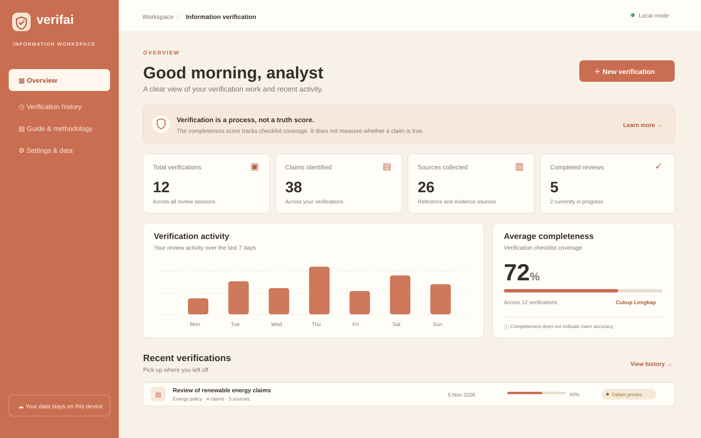
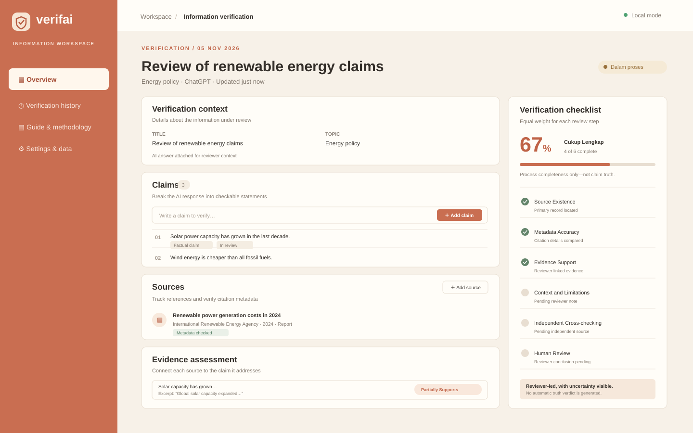

<div align="center">

# VERIFAI

### A calm workspace for checking AI-generated information.

Turn an answer into checkable claims, trace its sources, and document what the evidence does—and does not—support.

[Open the live app](https://kheiraaisya.github.io/VERIFAI-LDK-AI/) · [Report an issue](https://github.com/kheiraaisya/VERIFAI-LDK-AI/issues)

</div>

---

## Preview

The visuals below are UI illustrations based on the current VERIFAI interface. Numbers shown are examples for layout only; the app starts with an empty workspace and calculates its statistics from your browser data.

<p align="center">
  
</p>

<p align="center"><em>Overview of verification activity, saved work, and process completeness.</em></p>

<p align="center">
  
</p>

<p align="center"><em>A single workspace for claims, sources, evidence assessments, and reviewer notes.</em></p>

## Why VERIFAI?

AI-generated answers can sound confident while leaving out context, relying on weak sources, or presenting inaccurate details. VERIFAI helps people organize a careful review instead of treating an automated score as a verdict.

> **The completeness score measures the review process, not the truth of a claim.** A DOI record can help confirm citation metadata; it cannot show that a paper supports a particular statement. Final conclusions remain with the human reviewer.

## What you can do

- Create verification sessions for AI-generated answers.
- Break answers into editable claims and classify each statement.
- Record sources and compare DOI metadata with Crossref.
- Link excerpts to claims and assess whether evidence supports, partly supports, contradicts, or is insufficient.
- Track six equally weighted review steps: source existence, metadata accuracy, evidence support, context and limitations, independent cross-checking, and human review.
- Search and sort verification history.
- Export reports as PDF, CSV, or JSON; back up and restore workspace data as JSON.
- Keep work in the browser with no account, backend, or external database.

## Verification score

The score is the percentage of six checklist indicators marked complete:

```text
Completeness = completed checklist items / 6 × 100
```

It describes how much of the review process has been documented. It is **not** a confidence score, truth rating, or probability that a claim is correct.

## Run locally

Requirements: Node.js 20 or later and npm.

```bash
git clone https://github.com/kheiraaisya/VERIFAI-LDK-AI.git
cd VERIFAI-LDK-AI
npm ci
npm run dev
```

Vite prints a local URL, usually `http://localhost:5173/`.

## Build for production

```bash
npm run typecheck
npm run lint
npm run build
```

The static site is generated in `dist/` and can be hosted on GitHub Pages or another static host.

## GitHub Pages

The workflow at `.github/workflows/deploy.yml` builds and deploys the site whenever a commit reaches `main`.

1. Open **Settings → Pages** in the repository.
2. Set **Build and deployment → Source** to **GitHub Actions**.
3. Push to `main` or run the workflow manually from **Actions**.

The workflow sets the Vite base path for this repository and includes a fallback page for client-side routes.

## Data and privacy

- Verification records are stored in this browser's LocalStorage; they do not sync between devices.
- Data is not encrypted. Avoid storing sensitive personal information.
- Export a JSON backup before clearing browser data.
- DOI lookup sends the entered DOI to the public Crossref REST API. No secret API key is used.
- Metadata lookup does not inspect or validate the full contents of a paper.

## Technology

React · Vite · TypeScript · Tailwind CSS · React Router · Lucide · LocalStorage · Crossref REST API · jsPDF · PapaParse

## License

No license has been selected yet. All rights remain with the repository owner unless a license is added.
